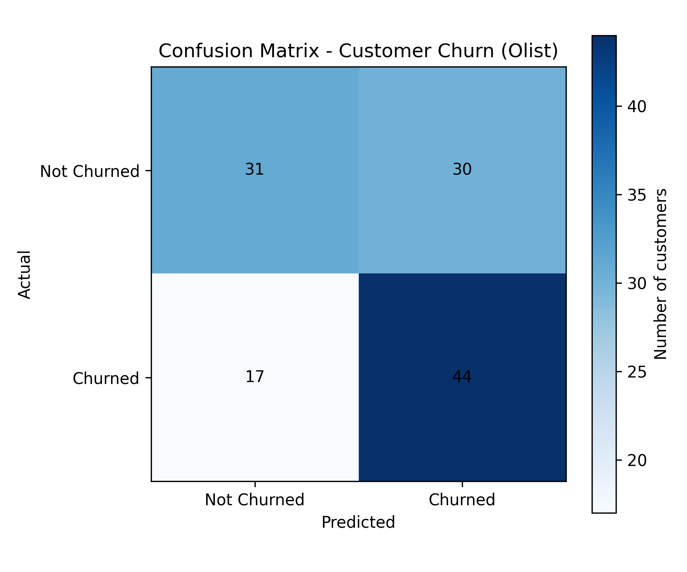
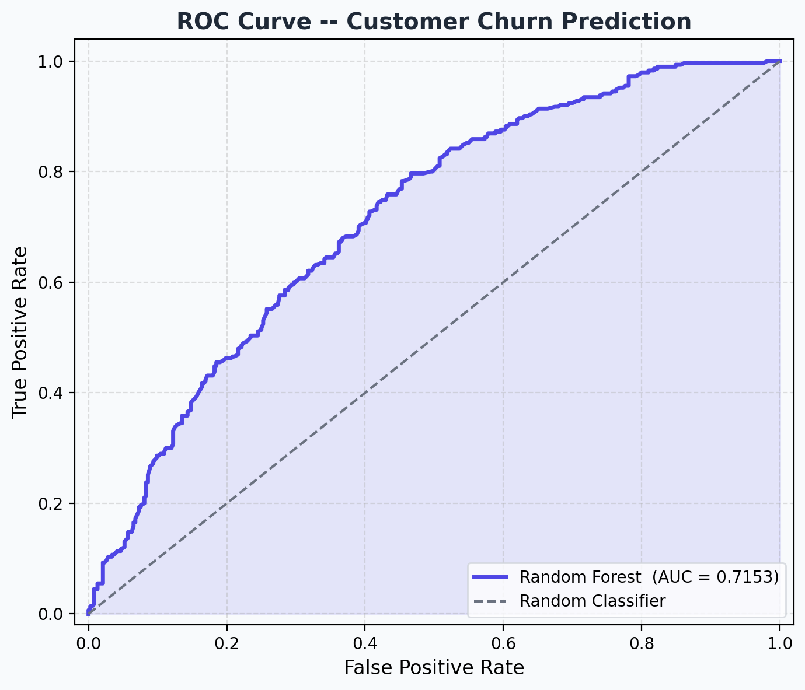
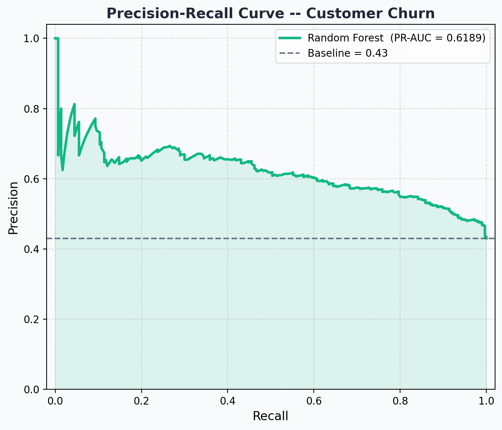
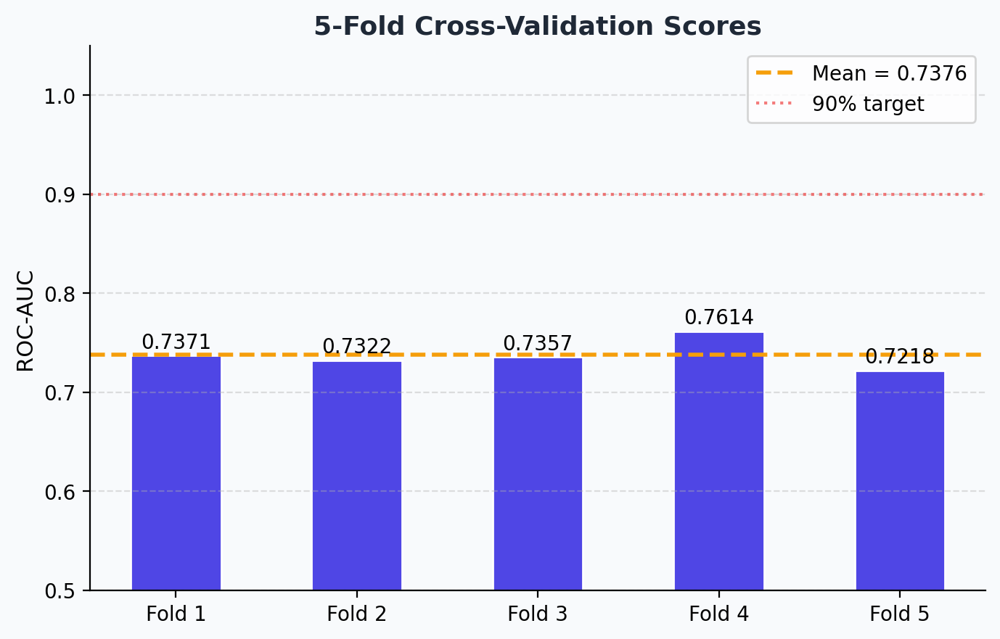
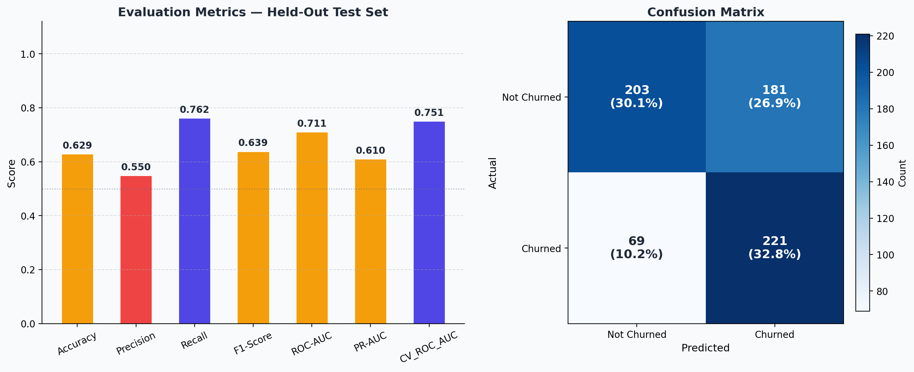
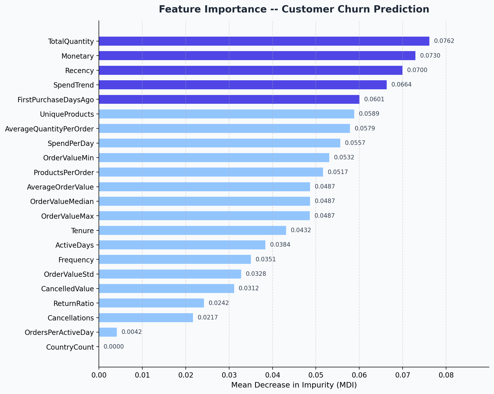
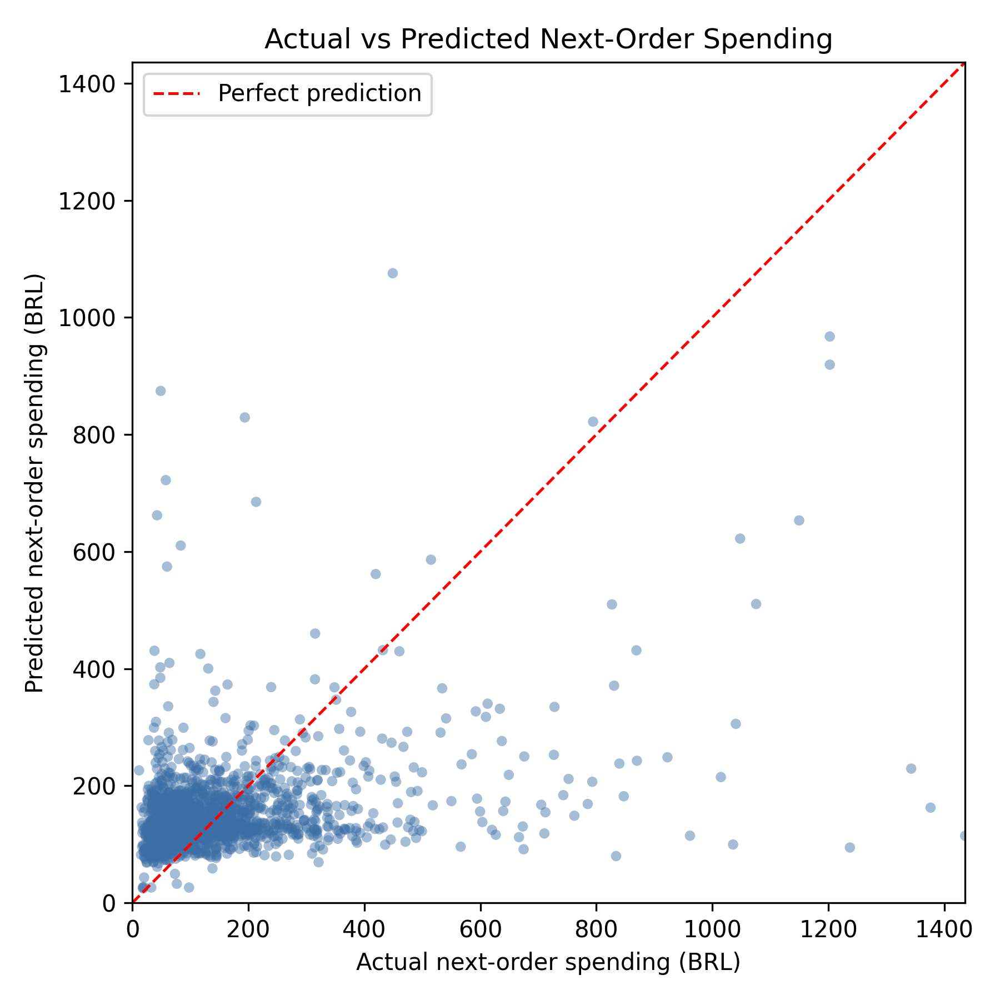
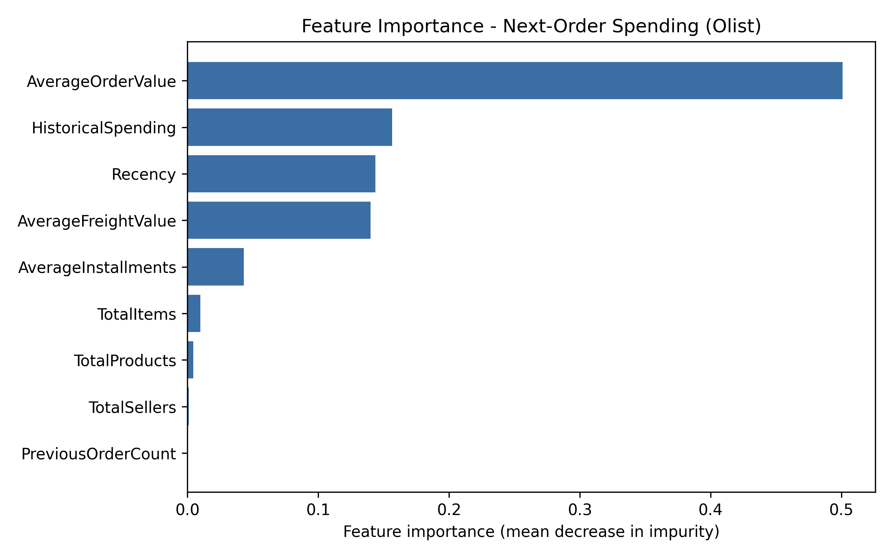
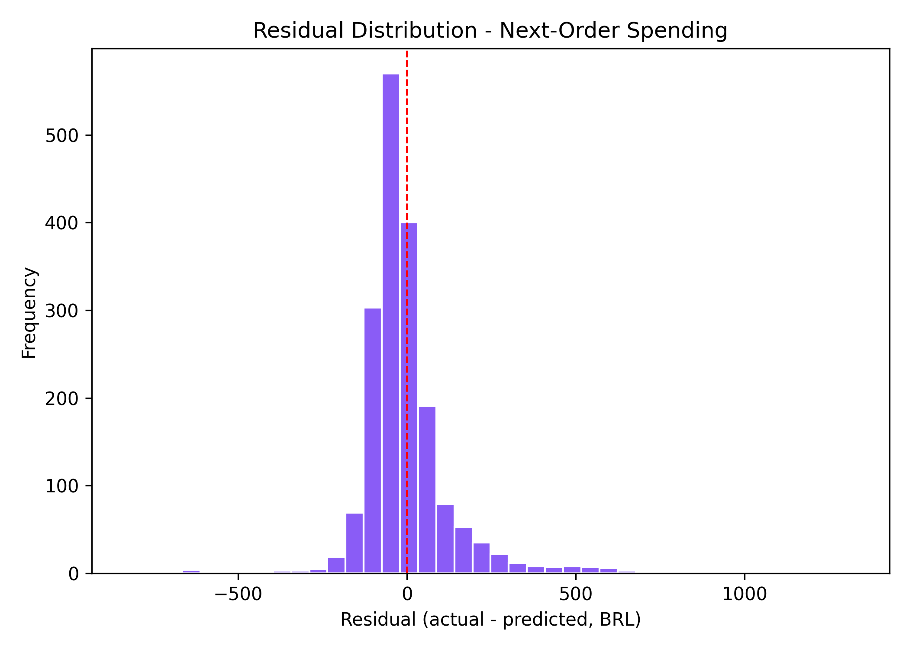
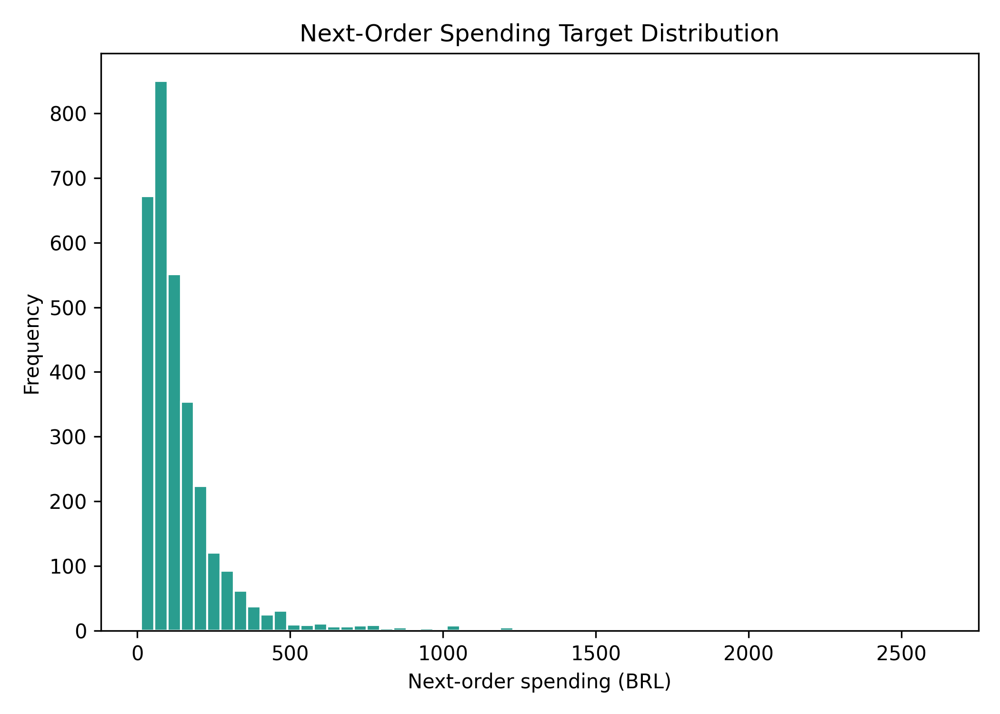

# E-commerce Customer Churn and Spending Prediction using Machine Learning

> **Research Paper Implementation** — Two Random Forest models (a churn classifier trained on an enriched RFM dataset derived from **Online Retail II**, and a next-order spending regressor trained on **Olist** prior-order history), deployed through a Flask web prototype, and combined into a prototype Customer Risk Value indicator.

---

## Table of Contents

1. [Project Overview](#1-project-overview)
2. [Research Questions](#2-research-questions)
3. [Solution Materials and Methodology](#3-solution-materials-and-methodology)
4. [Dataset](#4-dataset)
5. [Data Cleaning and Preprocessing](#5-data-cleaning-and-preprocessing)
6. [Feature Engineering](#6-feature-engineering)
7. [Machine Learning Algorithms Used](#7-machine-learning-algorithms-used)
8. [Tech Stack](#8-tech-stack)
9. [Project Workflow](#9-project-workflow)
10. [Project Structure](#10-project-structure)
11. [Setup and Installation](#11-setup-and-installation)
12. [Reproducing the Models](#12-reproducing-the-models)
13. [Running the Flask Application](#13-running-the-flask-application)
14. [What the Models Evaluate](#14-what-the-models-evaluate)
15. [Outputs and Results](#15-outputs-and-results)
16. [Output Screenshots](#16-output-screenshots)
17. [Customer Risk Value](#17-customer-risk-value)
18. [What Information the System Provides](#18-what-information-the-system-provides)
19. [Tests](#19-tests)
20. [Limitations and Threats to Validity](#20-limitations-and-threats-to-validity)
21. [Reproducibility](#21-reproducibility)

---

## 1. Project Overview

This project addresses two key business intelligence challenges in e-commerce through supervised machine learning:

| Task | Type | Description |
|---|---|---|
| **Customer Churn Prediction** | Binary Classification | Predicts whether a customer will churn (no purchase in the final 90 days of the observation window) |
| **Next-Order Spending Prediction** | Regression | Predicts the payment value (BRL) a customer will spend on their next order (conditional on that order existing) |

The two models are trained on **independent datasets**: the churn classifier on an enriched customer RFM dataset derived from **Online Retail II** (3,370 customers, 22 features), and the spending regressor on **Olist** prior-order history. The Flask prototype aligns each customer's churn probability with a predicted spending figure — via a shared `customer_id` or by row order — to form the combined indicator.

The two model outputs are combined into a prototype **Customer Risk Value** indicator:

```
Customer Risk Value (BRL) = Churn Probability × Predicted Next-Order Spending
```

Both models are served through a **Flask web application** that accepts CSV uploads, ranks customers by risk value, and returns a results table plus a summary.

> **Important:** The Customer Risk Value is a **prototype indicator**, not a validated financial estimate. The churn target is near-balanced (~43% of customers churn) and the spending target is conditional on a subsequent order existing.

---

## 2. Research Questions

| RQ | Question |
|---|---|
| **RQ1** | On a customer churn dataset, can a Random Forest distinguish customers who churn from those who stay active? |
| **RQ2** | Can a Random Forest predict the payment value of a customer's next order from prior-order history alone, without target leakage? |
| **RQ3** | Can the two model outputs be combined into a transparent, clearly-bounded risk indicator for demonstration purposes? |

---

## 3. Solution Materials and Methodology

### Approach Summary

Each model follows a standard supervised machine learning pipeline on its own source data:

```
RAW DATA (Online Retail II · Olist) → Clean & Aggregate → Feature Engineering → Split → Model Training → Evaluation → Serialization → Flask Deployment
```

### Methodology Steps

| Step | Churn Model | Spending Model |
|---|---|---|
| **1. Data Source** | Online Retail II (UCI 502) → `customer_churn_dataset_enriched.csv` | Olist Brazilian E-Commerce (delivered orders) |
| **2. Population** | 3,370 customers with purchase history | Repeat-customer order events (orders with prior history) |
| **3. Cleaning** | Customer RFM aggregation built in `notebooks/model1.ipynb` | Shared cleaning in `prepare_data.py` |
| **4. Features** | 22 enriched RFM + temporal/behavioural features | 9 prior-order cumulative features |
| **5. Target** | Churn = 1 if no purchase in the final 90 days | NextOrderSpending = payment value of the next order (conditional on it existing) |
| **6. Split** | Stratified 80/20 train/test (2,696 / 674) | Out-of-time: orders before vs after 2018-01-01 |
| **7. Model** | RandomForestClassifier (600 trees) | RandomForestRegressor (300 trees) |
| **8. Evaluation** | Accuracy, Precision, Recall, F1, ROC-AUC, PR-AUC | MAE, RMSE, R², Median AE |
| **9. Serialization** | `churn_model.pkl` + `churn_features.json` | `spending_model.pkl` + `spending_features.json` |

The spending model consumes the data layer produced by `prepare_data.py`; the churn model consumes the committed enriched churn dataset (produced by the legacy notebook).

---

## 4. Dataset

Two source datasets are used — one per model.

| Dataset | Source | Role | Size |
|---|---|---|---|
| **Online Retail II** | [UCI ML Repository, ID 502](https://archive.ics.uci.edu/dataset/502/online%2Bretail%2Bii) | **Churn model only** | 3,370 customers; raw workbook `data/online_retail_II.xlsx` |
| **Olist Brazilian E-Commerce** | [Kaggle `olistbr/brazilian-ecommerce`](https://www.kaggle.com/datasets/olistbr/brazilian-ecommerce) | **Spending model only** | 99,441 marketplace orders; raw tables in `olist_complete_dataset/` |

### Churn Dataset Details (Online Retail II)

- UK online-retail transactions, 2009–2011 (last invoice 2011-12-09); raw workbook `data/online_retail_II.xlsx`.
- `notebooks/model1.ipynb` cleans it into `data/customer_churn_dataset.csv` (9 RFM features), then enriches it into **`data/customer_churn_dataset_enriched.csv`** (22 features) — the file `train_churn.py` reads.
- **3,370 customers**, 22 features + `Churn` target; class balance **57.0% not churned / 43.0% churned**.

### Spending Dataset Details (Olist)

- Raw tables used by the pipeline: `olist_orders_dataset.csv`, `olist_customers_dataset.csv`, `olist_order_payments_dataset.csv`, `olist_order_items_dataset.csv`.
- The raw tables are joined directly in `prepare_data.py` (no intermediate notebook) into `data/olist_orders_joined.csv`.
- Only **delivered** orders with `payment_value > 0` are kept (96,477 orders, 93,357 customers).
- **Repeat customers (≥ 2 delivered orders): 2,801 (≈ 3.0%)** — this is the spending modelling population.

> `prepare_data.py` also emits `data/olist_churn_dataset.csv` (the earlier Olist churn snapshot), but the current churn model does **not** use it.

---

## 5. Data Cleaning and Preprocessing

### Churn Data (`notebooks/model1.ipynb`)

1. Load the raw Online Retail II workbook and parse `InvoiceDate`.
2. Drop rows without `Customer ID`; treat negative-`Quantity` invoices as cancellations.
3. Aggregate each customer into RFM + behavioural features (see [Feature Engineering](#6-feature-engineering)).
4. Set `observation_end = max(InvoiceDate) - 90 days`; the target window is the final 90 days.
5. `Churn = 1` if the customer has **no purchase** in that window, else `0`.

### Shared Cleaning for Spending (`prepare_data.py`)

1. Parse `order_purchase_timestamp` to datetime.
2. Aggregate **payments per order**: `payment_value = sum`, `payment_installments = max` (prevents double-counting multi-row payments).
3. Aggregate **items per order**: count items, distinct products, distinct sellers, sum item price, sum freight.
4. Join customers (to obtain `customer_unique_id`), payments, and items onto orders.
5. Keep only `order_status == "delivered"`.
6. Drop rows missing `customer_unique_id`, `order_purchase_timestamp`, or `payment_value`; keep `payment_value > 0`.
7. Sort by (`customer_unique_id`, `order_purchase_timestamp`) for chronological ordering.

### Spending Target Construction

- Sort each customer's orders chronologically.
- All features are cumulative sums of **prior orders only** (first order dropped — no history).
- `NextOrderSpending` = the **next** order's `payment_value` (BRL), conditional on that order existing.

---

## 6. Feature Engineering

### Churn Features — 22 Customer-Level Features

| Feature | Description |
|---|---|
| `Recency` | Days from the customer's last purchase to the observation end |
| `Frequency` | Number of orders (invoices) |
| `Monetary` | Total spend |
| `TotalQuantity` | Total units purchased |
| `AverageOrderValue` | Monetary ÷ Frequency |
| `AverageQuantityPerOrder` | Units per order (TotalQuantity ÷ Frequency) |
| `UniqueProducts` | Distinct products purchased |
| `ActiveDays` | Distinct days on which the customer ordered |
| `Tenure` | Days between first and last purchase |
| `FirstPurchaseDaysAgo` | Days from the first purchase to the observation end |
| `OrderValueStd` | Standard deviation of per-order value |
| `OrderValueMax` | Largest single-order value |
| `OrderValueMin` | Smallest single-order value |
| `OrderValueMedian` | Median single-order value |
| `OrdersPerActiveDay` | Frequency ÷ ActiveDays |
| `ProductsPerOrder` | UniqueProducts ÷ Frequency |
| `SpendPerDay` | Monetary ÷ Tenure |
| `CountryCount` | Distinct billing countries |
| `Cancellations` | Number of cancelled invoices |
| `CancelledValue` | Total value of cancelled invoices |
| `ReturnRatio` | CancelledValue ÷ (Monetary + CancelledValue) |
| `SpendTrend` | Trend in per-order value across the customer's order history |

**Churn Target Definition:**
- `Churn = 1` if the customer has **no purchase in the final 90 days** of the observation window
- `Churn = 0` otherwise
- **Base rate: 43.0% churned (1,449 / 3,370 customers)** — near-balanced, so no class weighting or resampling is used

### Spending Features — 9 Cumulative Historical Features

For each order, features are **cumulative sums of all previous orders only** (strict leakage control):

| Feature | Description |
|---|---|
| `Recency` | Days since the previous order |
| `PreviousOrderCount` | Count of prior orders (first order dropped — no history) |
| `HistoricalSpending` | Cumulative total spend from prior orders (BRL) |
| `TotalItems` | Cumulative total items from prior orders |
| `TotalProducts` | Cumulative distinct products from prior orders |
| `TotalSellers` | Cumulative distinct sellers from prior orders |
| `AverageOrderValue` | HistoricalSpending ÷ PreviousOrderCount |
| `AverageFreightValue` | Cumulative freight ÷ PreviousOrderCount |
| `AverageInstallments` | Cumulative installments ÷ PreviousOrderCount |

**Next-Order Spending Target:**
- `NextOrderSpending = the next order's payment_value (BRL)`
- Only orders with prior history are included (first order per customer dropped)
- **Leakage control**: target-order quantity, price, freight, and payment fields are never used as features

**Churn Dataset:** 3,370 customers × 22 features; target base rate 43.0% churned (1,449 customers).

**Resulting Spending Dataset (`outputs/dataset_summary.csv`):**

| Item | Value |
|---|---:|
| Delivered orders | 96,477 |
| Customers (delivered) | 93,357 |
| Repeat customers (≥ 2 orders) | 2,801 |
| Spending observations (train) | 1,300 |
| Spending observations (test) | 1,820 |
| NextOrderSpending mean (BRL) | 146.92 |
| NextOrderSpending median (BRL) | 100.30 |
| NextOrderSpending max (BRL) | 2,621.29 |

---

## 7. Machine Learning Algorithms Used

### Model 1 — Random Forest Classifier (Churn Prediction)

**Algorithm:** `sklearn.ensemble.RandomForestClassifier`

| Hyperparameter | Value | Rationale |
|---|---|---|
| `n_estimators` | 600 | Larger forest for variance reduction |
| `max_depth` | None | Fully grown trees; the enriched features support them |
| `min_samples_leaf` | 1 | Validated: does not overfit the 2,696-sample training set |
| `min_samples_split` | 2 | Default split rule |
| `max_features` | `sqrt` | Standard RF split rule (~√22 features per split) |
| `class_weight` | None | Target is near-balanced (~43% churn) |
| `random_state` | 42 | Reproducibility |
| `n_jobs` | -1 | Parallel training on all CPU cores |

**Split:** **stratified 80/20 random split** — 2,696 train / 674 test customers
(test churn rate 43.0%). **No class balancing** is applied because the target is
already near-balanced.

**Cross-Validation:** 5-fold Stratified K-Fold on the training split
(ROC-AUC = 0.7376 ± 0.0130).

### Model 2 — Random Forest Regressor (Spending Prediction)

**Algorithm:** `sklearn.ensemble.RandomForestRegressor`

| Hyperparameter | Value |
|---|---|
| `n_estimators` | 300 |
| `random_state` | 42 |
| `n_jobs` | -1 |

**Split Strategy:** **out-of-time** (chronological), not random:
- 1,300 train observations (orders before 2018-01-01) / 1,820 test observations (orders after)
- 1,178 train customers / 1,685 test customers; 62 customers appear in both
- Every observation still contributes only **prior-order** features, so the 62 overlap customers do not leak target information.

---

## 8. Tech Stack

| Category | Technology | Purpose |
|---|---|---|
| **Language** | Python 3.12 | Core implementation |
| **ML Framework** | scikit-learn ≥ 1.3 | RandomForestClassifier, RandomForestRegressor, metrics |
| **Data Processing** | pandas ≥ 2.0, numpy ≥ 1.24 | Data manipulation, feature engineering |
| **Model Persistence** | joblib ≥ 1.3 | Model serialisation / deserialisation |
| **Visualisation** | matplotlib ≥ 3.7 | All research figures (300 DPI) |
| **Web Framework** | Flask ≥ 3.0 | REST prototype with CSV upload |

### Dependencies (`requirements.txt`)
```
pandas>=2.0
numpy>=1.24
scikit-learn>=1.3
joblib>=1.3
matplotlib>=3.7
openpyxl>=3.1
Flask>=3.0
```

---

## 9. Project Workflow

```
┌─────────────────────────────────────────────────────────────────────────┐
│                    MACHINE LEARNING PIPELINE (two models)                │
└─────────────────────────────────────────────────────────────────────────┘

  CHURN PATH                                 SPENDING PATH

  ┌───────────────────────────┐              ┌───────────────────────────┐
  │ Online Retail II workbook │              │ RAW OLIST TABLES          │
  │ data/online_retail_II.xlsx│              │ (olist_complete_dataset/) │
  └────────────┬──────────────┘              └────────────┬──────────────┘
               │ notebooks/model1.ipynb                   │ prepare_data.py
               ▼                                         ▼
  ┌───────────────────────────┐              ┌───────────────────────────┐
  │ CHURN DATASET             │              │ DELIVERED-ORDER TABLE     │
  │ customer_churn_dataset_   │              │ data/olist_orders_joined  │
  │   enriched.csv            │              └────────────┬──────────────┘
  │ 22 enriched features      │                           ▼
  │ Churn target (90 days)    │              ┌───────────────────────────┐
  └────────────┬──────────────┘              │ SPENDING DATASET          │
               │                             │ 9 cumulative features     │
               ▼                             │ NextOrderSpending target  │
  ┌───────────────────────────┐              └────────────┬──────────────┘
  │ SPLIT  stratified 80/20   │                           │
  │ 2696 train / 674 test     │                           ▼
  └────────────┬──────────────┘              ┌───────────────────────────┐
               │                             │ SPLIT  out-of-time        │
               ▼                             │ 1300 / 1820 observations  │
  ┌───────────────────────────┐              └────────────┬──────────────┘
  │ RandomForest Classifier   │                           │
  │ 600 trees, fully grown    │                           ▼
  └────────────┬──────────────┘              ┌───────────────────────────┐
               │                             │ RandomForest Regressor    │
               ▼                             │ 300 trees                 │
  ┌───────────────────────────┐              └────────────┬──────────────┘
  │ Acc:      0.6588          │                           │
  │ ROC-AUC:  0.7153          │                           ▼
  │ CV ROC-AUC: 0.7376        │              ┌───────────────────────────┐
  └────────────┬──────────────┘              │ MAE:  93.90 BRL           │
               │                             │ RMSE: 150.16 BRL          │
               ▼                             │ R²:   0.0426              │
  ┌───────────────────────────┐              └────────────┬──────────────┘
  │ churn_model.pkl           │                           │
  │ churn_features.json       │                           ▼
  └────────────┬──────────────┘              ┌───────────────────────────┐
               │                             │ spending_model.pkl        │
               │                             │ spending_features.json    │
               │                             └────────────┬──────────────┘
               └──────────────────┬───────────────────────┘
                                  ▼
                ┌──────────────────────────────────┐
                │   FLASK APPLICATION              │
                │   app.py                         │
                │   • Churn CSV (22 cols)          │
                │   • Spend CSV (9 cols)           │
                │   • Risk value + segments        │
                │   • Ranked table + summary       │
                └──────────────────────────────────┘
```

---

## 10. Project Structure

```text
Research_Paper/
├── prepare_data.py                 Olist spending prep (join → clean → datasets)
├── train_churn.py                  Train churn model, metrics, and figures
├── train_spending.py               Train spending model, metrics, and figures
├── app.py                          Flask application (churn + spending + risk value)
├── requirements.txt                Python dependencies
│
├── data/
│   ├── olist_orders_joined.csv     Joined delivered orders (generated)
│   ├── olist_churn_dataset.csv     [unused] earlier Olist churn snapshot
│   ├── olist_spending_dataset_prepared.csv  Next-order event dataset (generated)
│   ├── online_retail_II.xlsx       Raw churn source (Online Retail II)
│   ├── online_retail_II_cleaned.csv Cleaned source (notebook output)
│   ├── customer_churn_dataset.csv  Churn base dataset, 9 RFM features (notebook)
│   ├── customer_churn_dataset_     Churn model input, 22 features
│   │   enriched.csv                (notebook output; used by train_churn.py)
│   ├── ecommerce_customers.csv     [legacy] supplemental reference
│   ├── olist_spending_dataset.csv  [legacy] old ad-hoc join (unused)
│   └── olist_spending_cleaned.csv  [legacy] (unused)
│
├── olist_complete_dataset/         Raw Olist source tables
│   ├── olist_orders_dataset.csv
│   ├── olist_customers_dataset.csv
│   ├── olist_order_payments_dataset.csv
│   ├── olist_order_items_dataset.csv
│   └── (geolocation, reviews, products, sellers, translation — not used)
│
├── models/
│   ├── churn_model.pkl             Serialised Random Forest Classifier
│   ├── churn_features.json         Ordered feature names for churn model
│   ├── spending_model.pkl          Serialised Random Forest Regressor
│   ├── spending_features.json      Ordered feature names for spending model
│   └── risk_thresholds.json        Segment cut-offs (t1, t2)
│
├── outputs/                        Research tables, figures, reports
│   ├── README.md                   Output file catalogue
│   ├── implementation_report.md    Full methodology and interpretations
│   ├── churn_evaluation_metrics.csv
│   ├── churn_classification_report.csv
│   ├── churn_confusion_matrix.csv
│   ├── churn_feature_importance.csv
│   ├── churn_predictions.csv
│   ├── spending_evaluation_metrics.csv
│   ├── spending_feature_importance.csv
│   ├── spending_predictions.csv
│   ├── customer_risk_value_examples.csv
│   ├── dataset_summary.csv
│   ├── experiment_configuration.json
│   ├── churn_confusion_matrix.png
│   ├── churn_feature_importance.png
│   ├── churn_roc_curve.png
│   ├── churn_precision_recall_curve.png
│   ├── churn_metrics_dashboard.png
│   ├── churn_cv_scores.png
│   ├── spending_feature_importance.png
│   ├── spending_actual_vs_predicted.png
│   ├── spending_residuals.png
│   └── spending_target_distribution.png
│
├── templates/
│   └── index.html                  Flask UI (two uploads + ranked results + summary)
│
├── sample_inputs/
│   ├── churn_input.csv             10 example churn rows (22 features + customer_id)
│   └── spending_input.csv          10 example spending rows (9 features + customer_id)
│
├── docs/
│   ├── Info.md                     [legacy] project notes
│   └── sample_report.pdf           [legacy] sample report reference
│
├── notebooks/
│   ├── model1.ipynb                Builds the churn dataset (Online Retail II)
│   └── model2.ipynb                [legacy] early spending experiments
│
└── tests/
    └── test_pipeline.py            Automated pipeline tests (11 tests)
```

> `[legacy]` files are retained for provenance but are **not used** by the current pipeline.

---

## 11. Setup and Installation

### Prerequisites
- Python 3.9 or higher
- pip

### Installation

```bash
# Clone or navigate to the project directory
cd Research_Paper

# Install all dependencies
pip install -r requirements.txt
```

---

## 12. Reproducing the Models

All scripts use `random_state=42` and write results to `outputs/`.

```bash
# Step 1: Build the Olist spending datasets from the raw Olist tables
# Reads:  olist_complete_dataset/*.csv
# Writes: data/olist_orders_joined.csv
#         data/olist_spending_dataset_prepared.csv
#         data/olist_churn_dataset.csv  (legacy, unused by train_churn.py)
python prepare_data.py

# Step 2: Train the spending model
# Reads:  data/olist_spending_dataset_prepared.csv
# Writes: models/spending_model.pkl, models/spending_features.json,
#         models/risk_thresholds.json, outputs/spending_*.{csv,png},
#         outputs/dataset_summary.csv, outputs/experiment_configuration.json
python train_spending.py

# Step 3: Train the churn model
# Reads:  data/customer_churn_dataset_enriched.csv
#         (pre-built by notebooks/model1.ipynb from data/online_retail_II.xlsx)
# Writes: models/churn_model.pkl, models/churn_features.json,
#         outputs/churn_*.{csv,png}
python train_churn.py
```

> All scripts are deterministic (`random_state=42`) — reruns reproduce the reported metrics.

---

## 13. Running the Flask Application

```bash
python app.py               # Starts at http://127.0.0.1:5000
```

### Application Workflow

1. Navigate to `http://127.0.0.1:5000`
2. Upload two CSV files:
   - **Churn Feature CSV** — 22 RFM/behavioural columns (+ optional `customer_id`)
   - **Spending Feature CSV** — 9 prior-order columns (+ optional `customer_id`)
3. Click **Predict and rank by risk value**
4. View the results:
   - **Summary panel** — customers analysed, mean churn probability, mean predicted spending, mean and total risk value
   - **Risk-segment panel** — Low / Medium / High with thresholds and per-segment counts and averages
   - **Ranked table** — customers sorted by Customer Risk Value (highest first)

### Sample Input Files

Use the provided samples in `sample_inputs/` (10 customers each, aligned by `customer_id`):

```bash
# Churn input: 22 feature columns + optional customer_id
sample_inputs/churn_input.csv

# Spending input: 9 feature columns + optional customer_id
sample_inputs/spending_input.csv
```

Both sample files use the same identifiers (`C001`–`C010`), so the demo joins them on `customer_id`. With the current models these 10 customers fall into the **Low** (6) and **High** (4) risk segments.

**Churn CSV required columns (22):**
```
Recency, Frequency, Monetary, TotalQuantity, AverageOrderValue,
AverageQuantityPerOrder, UniqueProducts, ActiveDays, Tenure,
FirstPurchaseDaysAgo, OrderValueStd, OrderValueMax, OrderValueMin,
OrderValueMedian, OrdersPerActiveDay, ProductsPerOrder, SpendPerDay,
CountryCount, Cancellations, CancelledValue, ReturnRatio, SpendTrend
```

**Spending CSV required columns (9):**
```
Recency, PreviousOrderCount, HistoricalSpending, TotalItems,
TotalProducts, TotalSellers, AverageOrderValue,
AverageFreightValue, AverageInstallments
```

### Row Pairing Logic

| Scenario | Behaviour |
|---|---|
| Both files contain `customer_id` | Inner join on `customer_id` |
| One or both files missing `customer_id` | Paired by row order; extra rows ignored |

### Validation Rules

The app rejects uploads with:
- Missing required feature columns
- Non-numeric feature values
- Missing (NaN) feature values
- Negative values in spending features
- Empty files or unreadable CSVs

Returns **HTTP 400** with a descriptive error message per file.

---

## 14. What the Models Evaluate

### Model 1: Churn Classifier — What It Evaluates

The churn model evaluates **binary classification** on a stratified 80/20
held-out test set (674 customers, 43.0% churn). Because the target is
near-balanced, every metric below is computed on the natural test distribution —
no oversampling, undersampling or class weighting is applied:

| Metric | Formula | What It Tells You |
|---|---|---|
| **Accuracy** | Correct predictions ÷ Total | Overall proportion correct (on a near-balanced target this is meaningful) |
| **Precision** | TP ÷ (TP + FP) | Of customers predicted as churners, how many actually churned |
| **Recall** | TP ÷ (TP + FN) | Of actual churners, how many were correctly identified |
| **F1-Score** | 2 × (Precision × Recall) ÷ (Precision + Recall) | Harmonic mean of Precision and Recall |
| **ROC-AUC** | Area under the ROC curve | Ability to rank churners above non-churners (0.5 = random) |
| **PR-AUC** | Area under Precision–Recall curve | Precision/recall balance; baseline equals the 43% churn rate |
| **Confusion Matrix** | TN, FP, FN, TP counts | Per-class error breakdown |
| **CV ROC-AUC** | 5-fold Stratified K-Fold on train | Generalisation estimate that never touches the test set |

### Model 2: Spending Regressor — What It Evaluates

The spending model evaluates **regression performance** on 1,820 held-out observations (orders placed after 2018-01-01):

| Metric | Formula | What It Tells You |
|---|---|---|
| **MAE** | Mean(|actual − predicted|) | Average absolute error in BRL — interpretable dollar amount |
| **RMSE** | √Mean((actual − predicted)²) | Square-root error; penalises large errors more than MAE |
| **R²** | 1 − SS_res ÷ SS_tot | Proportion of variance explained (0 = mean-only model, 1 = perfect) |
| **Median AE** | Median(|actual − predicted|) | Robust error estimate; less sensitive to outliers than MAE |

---

## 15. Outputs and Results

### Churn Model Results (held-out test: 674 customers, 43.0% churn)

| Metric | Value |
|---|---:|
| Accuracy | **0.6588** |
| Precision (Churned) | 0.6042 |
| Recall (Churned) | 0.6000 |
| F1-Score (Churned) | 0.6021 |
| **ROC-AUC** | **0.7153** |
| PR-AUC | 0.6189 |
| 5-fold CV ROC-AUC (train) | 0.7376 ± 0.0130 |

**Confusion Matrix (held-out test):**

|  | Predicted: Not Churned | Predicted: Churned |
|---|---:|---:|
| **Actual: Not Churned** | 270 (TN) | 114 (FP) |
| **Actual: Churned** | 116 (FN) | 174 (TP) |

**Per-class report:**

| Class | Precision | Recall | F1-score | Support |
|---|---:|---:|---:|---:|
| Not Churned | 0.6995 | 0.7031 | 0.7013 | 384 |
| Churned | 0.6042 | 0.6000 | 0.6021 | 290 |

> Accuracy 0.659 beats the majority-class baseline (0.570) by ~9 points, and
> ROC-AUC 0.715 / PR-AUC 0.619 (vs. 0.43 baseline) indicate a **modest but real**
> signal. The 5-fold CV ROC-AUC (0.738 ± 0.013) is the more trustworthy
> generalisation estimate; the target is near-balanced, so no resampling was
> used and these numbers are directly comparable to the natural class mix.

### Spending Model Results (out-of-time: 1,820 orders after 2018-01-01)

| Metric | Value |
|---|---:|
| MAE (BRL) | **93.90** |
| RMSE (BRL) | **150.16** |
| R² | **0.0426** |
| Median AE (BRL) | **60.52** |

**Predicted vs Actual Summary:**

| Statistic | Actual (BRL) | Predicted (BRL) | Residual (BRL) |
|---|---:|---:|---:|
| Mean | 148.75 | 157.70 | -8.94 |
| Std | 153.51 | 82.97 | 149.94 |
| Min | 11.56 | 26.83 | -739.41 |
| Median | 104.40 | 137.36 | -28.30 |
| Max | 1435.97 | 797.11 | 1314.01 |

> R² = 0.043 means prior-order history explains ~4% of held-out next-order variance — a **weak but positive** signal. The narrower predicted range shows the regressor shrinks toward the mean (typical for tree ensembles on skewed targets).

### Top Feature Importances

**Churn Model — Feature importance (mean decrease in impurity):**

| Rank | Feature | Importance |
|---:|---|---:|
| 1 | TotalQuantity | 0.076 |
| 2 | Monetary | 0.073 |
| 3 | Recency | 0.070 |
| 4 | SpendTrend | 0.066 |
| 5 | FirstPurchaseDaysAgo | 0.060 |
| 6 | UniqueProducts | 0.059 |
| 7 | AverageQuantityPerOrder | 0.058 |
| 8 | SpendPerDay | 0.056 |
| 9 | OrderValueMin | 0.053 |
| 10 | ProductsPerOrder | 0.052 |
| 11 | AverageOrderValue | 0.049 |
| 12 | OrderValueMedian | 0.049 |
| 13 | OrderValueMax | 0.049 |
| 14 | Tenure | 0.043 |
| 15 | ActiveDays | 0.038 |
| 16 | Frequency | 0.035 |
| 17 | OrderValueStd | 0.033 |
| 18 | CancelledValue | 0.031 |
| 19 | ReturnRatio | 0.024 |
| 20 | Cancellations | 0.022 |
| 21 | OrdersPerActiveDay | 0.004 |
| 22 | CountryCount | 0.000 |

Importance is spread almost evenly (no feature above 0.08), which is consistent
with the modest single-feature AUCs — a weak-signal problem rather than one
dominant predictor.

**Spending Model — Feature importance (mean decrease in impurity):**

| Rank | Feature | Importance |
|---:|---|---:|
| 1 | AverageOrderValue | 0.349 |
| 2 | HistoricalSpending | 0.202 |
| 3 | Recency | 0.185 |
| 4 | AverageFreightValue | 0.176 |
| 5 | AverageInstallments | 0.062 |
| 6 | TotalItems | 0.015 |
| 7 | TotalProducts | 0.007 |
| 8 | TotalSellers | 0.002 |
| 9 | PreviousOrderCount | 0.001 |

> Feature importance reflects **predictive contribution within the fitted forest**, not causation.

### Earlier 8-feature vs Current 22-feature Churn Model

| Aspect | Earlier churn model | Current churn model |
|---|---|---|
| Features | 8 RFM-style | 22 enriched RFM + behavioural |
| Model | RandomForestClassifier, `max_depth=6`, `class_weight="balanced"` | RandomForestClassifier, 600 trees, fully grown |
| Split | stratified 80/20 | stratified 80/20 |
| Accuracy | 0.6291 | **0.6588** |
| Precision (Churned) | 0.5498 | **0.6042** |
| Recall (Churned) | **0.7621** | 0.6000 |
| F1-Score (Churned) | **0.6387** | 0.6021 |
| ROC-AUC | 0.7107 | **0.7153** |
| PR-AUC | 0.6104 | **0.6189** |
| CV ROC-AUC | **0.7505** | 0.7376 |

> The 22-feature enriched model improves accuracy, precision, ROC-AUC and PR-AUC.
> It trades away some recall and F1 versus the earlier balanced 8-feature model,
> so the two are not strictly ordered — the enriched model is preferred for its
> higher accuracy and precision at a similar ROC-AUC. The spending model is
> unchanged (RandomForestRegressor on Olist prior-order history; R² = 0.0426
> out-of-time).

---

## 16. Output Screenshots

### Churn Model — Confusion Matrix

Confusion matrix on the held-out test set (674 customers, 43.0% churn). TN = 270, FP = 114, FN = 116, TP = 174 — the model correctly identifies 174 of 290 churners (recall 0.60) while keeping 270 of 384 active customers correct.



---

### Churn Model — ROC Curve

The ROC curve plots True Positive Rate against False Positive Rate across thresholds. AUC = 0.7153 indicates the model ranks churners above non-churners better than chance (0.5).



---

### Churn Model — Precision-Recall Curve

Precision–recall trade-off on the held-out test set (PR-AUC = 0.6189, versus a 0.43 no-skill baseline).



---

### Churn Model — 5-Fold Cross-Validation

Per-fold ROC-AUC on the training split (mean 0.7376 ± 0.013) — the more reliable generalisation estimate.



---

### Churn Model — Metrics Dashboard

All headline metrics and the confusion matrix in one view.



---

### Churn Model — Feature Importance

`TotalQuantity` (0.076), `Monetary` (0.073) and `Recency` (0.070) lead, but importance is spread almost evenly across all 22 features — consistent with the weak overall signal.



---

### Spending Model — Actual vs Predicted

Actual vs predicted next-order spending on the held-out orders. Points on the red dashed line are perfect predictions; the model regresses toward the mean (predicted range is narrower than actual), typical for Random Forest regressors on skewed targets.



---

### Spending Model — Feature Importance

`AverageOrderValue` (0.349) is the strongest predictor of next-order spending, followed by `HistoricalSpending` (0.202) and `Recency` (0.185). The top 4 features account for ~91% of total importance.



---

### Spending Model — Residual Distribution

The residual histogram (actual − predicted) is centred slightly below zero, with most residuals within ±250 BRL. A small number of large residuals correspond to high-value actual orders the model underestimates.



---

### Spending Model — Target Distribution

The next-order spending distribution is right-skewed, with most orders below BRL 500 and a long tail extending to ~BRL 2,600. This skewness contributes to the low R² and is a key modelling challenge.



---

## 17. Customer Risk Value

### Formula

```
Customer Risk Value (BRL) = Churn Probability × Predicted Next-Order Spending
```

Where:
- **Churn Probability** ∈ [0.0, 1.0] — output of the Random Forest Classifier
- **Predicted Next-Order Spending** ≥ 0 (BRL) — output of the Random Forest Regressor (clipped to non-negative)

### Risk Segments (mathematically defined)

Thresholds are the **33rd and 66th percentiles of the held-out predicted-spending distribution**, stored in `models/risk_thresholds.json`:

| Segment | Rule | Threshold |
|---|---|---|
| **Low** | `R ≤ t1` | `t1 = 120.09` |
| **Medium** | `t1 < R ≤ t2` | `t2 = 150.60` |
| **High** | `R > t2` | — |

The churn base rate on this population is ~43%; the churn model is trained on
the natural (near-balanced) class mix, so its probabilities spread across the
full [0, 1] range rather than clustering at an extreme. The risk value is driven
by both churn probability and predicted spending.

### Interpretation

| Churn Probability | Predicted Spending (BRL) | Risk Value (BRL) | Interpretation |
|---:|---:|---:|---|
| 0.00 | 500.00 | 0.00 | No churn risk — no at-risk revenue |
| 0.25 | 500.00 | 125.00 | 25% churn risk on R$500 potential spend |
| 0.50 | 500.00 | 250.00 | Equal chance of churning, R$250 at risk |
| 0.75 | 500.00 | 375.00 | High churn risk, R$375 potential loss |
| 1.00 | 500.00 | 500.00 | Full spend value at risk |

Illustrative sensitivity examples are in `outputs/customer_risk_value_examples.csv`.

### Limitations

> **The Customer Risk Value is a prototype demonstration indicator, not a validated financial estimate.**
> - The churn target is near-balanced (~43% base rate) and the spending target is **conditional on a subsequent order existing**
> - The two models are trained on **different datasets** (Online Retail II for churn, Olist for spending), so a "customer" only aligns if the analyst supplies matching identifiers — the combined value is a demonstration, not a per-customer truth
> - No causal relationship between churn and revenue loss is established
> - Churn probabilities are relative risk scores, not calibrated real-world dormancy rates
> - The combined value should be treated as a relative prioritisation signal only

---

## 18. What Information the System Provides

### Per-Customer Predictions (Flask App Output)

For each row in the uploaded CSVs, the system returns:

| Output Field | Type | Description |
|---|---|---|
| `customer_id` | String | Customer identifier (if provided), otherwise `row_N` |
| `churn_probability` | Float [0, 1] | Estimated probability that the customer has churned |
| `predicted_churn` | String | `"Churned"` or `"Not Churned"` (threshold: 0.5) |
| `predicted_next_order_spending_BRL` | Float ≥ 0 | Predicted BRL value of the customer's next order |
| `customer_risk_value_BRL` | Float ≥ 0 | churn_probability × predicted_next_order_spending_BRL |
| `risk_segment` | String | `"Low"`, `"Medium"`, or `"High"` per the thresholds above |

Rows are **sorted by Customer Risk Value (highest first)** and the page is labelled a **prototype estimate**.

### Batch Summary Statistics

The results page also shows:
- **Customers analysed**
- **Mean churn probability**
- **Mean predicted spending**
- **Mean Customer Risk Value**
- **Total Customer Risk Value** (portfolio-level indicator)
- **Per-segment counts and averages** (Low / Medium / High)
- **Pairing note**: whether rows were joined on `customer_id` or paired by row order

### Research Output Files (Generated by Training Scripts)

| File | Description |
|---|---|
| `outputs/churn_evaluation_metrics.csv` | Accuracy, Precision, Recall, F1, ROC-AUC, PR-AUC, CV ROC-AUC (+ std) |
| `outputs/churn_classification_report.csv` | Per-class precision/recall/F1/support |
| `outputs/churn_confusion_matrix.csv` | TN/FP/FN/TP counts |
| `outputs/churn_feature_importance.csv` | Feature importance scores (all 22 features) |
| `outputs/churn_predictions.csv` | Per-test-customer features, actual/predicted churn, probability |
| `outputs/spending_evaluation_metrics.csv` | MAE, RMSE, R², Median AE |
| `outputs/spending_feature_importance.csv` | Feature importance scores (all 9 features) |
| `outputs/spending_predictions.csv` | Actual, predicted, residual per test observation |
| `outputs/customer_risk_value_examples.csv` | Example risk values at 5 churn probability levels |
| `outputs/dataset_summary.csv` | Dataset row/customer counts and target statistics |
| `outputs/experiment_configuration.json` | Spending model config, feature order, split info, verification |
| `outputs/implementation_report.md` | Full methodology, interpretations, and limitations |

---

## 19. Tests

```bash
# Run all tests
python tests/test_pipeline.py

# Or with pytest
pytest tests/test_pipeline.py -v
```

**Results: 11 passed, 0 failed**

| Test | Description |
|---|---|
| Churn model load | Model file exists and is loadable |
| Churn model type | Confirms `RandomForestClassifier` |
| Churn feature count | Model expects exactly 22 features |
| Churn probability range | All probabilities ∈ [0, 1] |
| Churn output shape | Output shape matches input rows |
| Spending model load | Model file exists and is loadable |
| Spending model type | Confirms `RandomForestRegressor` |
| Spending feature count | Model expects exactly 9 features |
| Spending feature order match | Saved JSON order matches model training order |
| Spending prediction finite | No NaN or Inf in predictions |
| Risk value: edge cases | prob = 0 → 0; prob = 1 → spending; intermediate; non-negative |
| Flask main route | GET / returns HTTP 200 |
| Valid two-file upload | Produces results table with risk column |
| Missing churn columns | Returns HTTP 400 with error message |
| Missing spending columns | Returns HTTP 400 with error message |
| Non-numeric rejection | Returns HTTP 400 for non-numeric feature values |
| Row-order pairing | Pairs by row order when customer_id absent |

---

## 20. Limitations and Threats to Validity

| Limitation | Description |
|---|---|
| **Moderate churn signal** | Accuracy 0.659 / ROC-AUC 0.715 on the held-out test (5-fold CV ROC-AUC 0.738 ± 0.013). The model beats the 0.570 majority-class baseline, but the 22 features carry only a modest signal — the best single-feature AUC is 0.72 |
| **Conditional spending target** | The spending model predicts the next order's value **conditional on a subsequent order existing** — never-reordering customers are excluded from the regression set |
| **Weak spending signal** | R² = 0.043 — prior-order history explains only ~4% of held-out variance; predictions are weak signals for individuals |
| **Models use different datasets** | The churn model is trained on Online Retail II (UK) and the spending model on Olist (Brazil); the combined risk value only aligns a "customer" when matching identifiers are supplied |
| **Not a subscription business** | "Churn" means long-run inactivity, not contract cancellation |
| **Horizon / cut-off choices** | The 90-day churn window and the 2018-01-01 / 2018-04-01 spending cut-offs are design choices, not validated optima |
| **No significance testing** | Metric differences are not tested for statistical significance |
| **Feature importance ≠ causation** | MDI importance reflects predictive contribution, not causal effect |
| **Risk value not financially validated** | It is a prototype demonstration, not a validated financial or business outcome |

---

## 21. Reproducibility

All scripts use `random_state=42` for full determinism.

```bash
# 1. Install dependencies
pip install -r requirements.txt

# 2. Build the Olist spending datasets from the raw Olist tables
python prepare_data.py
# → data/olist_orders_joined.csv
# → data/olist_spending_dataset_prepared.csv
# (the churn input data/customer_churn_dataset_enriched.csv is pre-built by notebooks/model1.ipynb)

# 3. Reproduce the spending model, metrics, and figures
python train_spending.py
# → models/spending_model.pkl, models/spending_features.json, models/risk_thresholds.json
# → outputs/spending_*.csv, outputs/spending_*.png
# → outputs/dataset_summary.csv, outputs/experiment_configuration.json

# 4. Reproduce the churn model, metrics, and figures
python train_churn.py
# → models/churn_model.pkl, models/churn_features.json
# → outputs/churn_*.csv, outputs/churn_*.png

# 5. Start the Flask application
python app.py
# → http://127.0.0.1:5000

# 6. Run automated tests
python tests/test_pipeline.py
# → 11 passed, 0 failed
```

Full methodology, interpretations, and limitations are documented in [`outputs/implementation_report.md`](outputs/implementation_report.md).

---

*Research paper implementation — E-commerce Customer Churn and Spending Prediction using Machine Learning*
